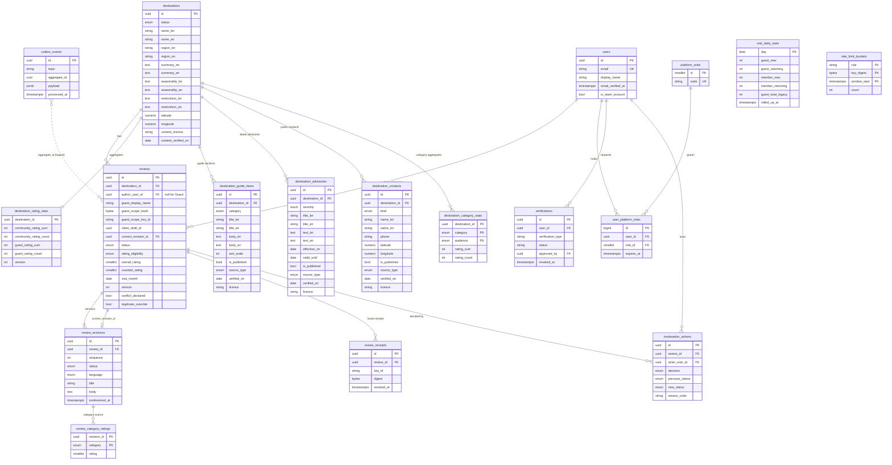

# Abhijatri Database Schema (ERD)

**Status:** Draft for F02 review, 15 October 2026; destination content tables added for R02 on 19 October 2026. Source of truth for implemented tables is `backend/app/models.py` and `backend/migrations/`; planned tables come from `Features/Review.md` section 9.1 and the Gantt tasks named below. A test (`backend/tests/test_docs_schema.py`) fails if an implemented table is missing from this file.

Database: PostgreSQL 17 (Supabase-managed in shared environments). Schema changes go through Alembic only.

## 1. Entity-relationship diagram

## 2. Implemented tables

| Table | Purpose | Key constraints and indexes | Privacy class |
|---|---|---|---|
| `destinations` | Bilingual destination identity, publication state and profile text (region, summary, seasonality, restrictions, coordinates, content licence). Profile columns are nullable until R01 content is entered. | PK `id`; enum `destination_status`; `ck_destination_latitude_range`, `ck_destination_longitude_range`, `ck_destination_coordinates_pair`; partial index `ix_destinations_published_name`. | Public when `PUBLISHED` |
| `users` | Account identity; `id` equals the Supabase Auth user id (created on first verified sign-in). `first_visit_on` / `last_visit_on` (migration `0009`) are member visit days for the Verified visit counts, written by `GET /auth/session`. `status` / `disabled_at` (migration `0010`): a disabled account fails closed everywhere. | Unique `email`; `ck_users_status` (`active`, `disabled`). | Personal data |
| `user_roles` | Staff role grants (Moderation spec 2.2, migration `0010`): `moderator` or `superadmin`, with who granted and revoked and when. Replaces `user_platform_roles` for authorization. | `ck_user_roles_role`; partial unique index `uq_user_roles_one_active (user_id) WHERE revoked_at IS NULL` (at most one active role per user). | Internal |
| `role_admin_guard` | A single row (`id = 1`) locked `FOR UPDATE` to serialise superadmin grants and revocations (spec 6.1). | `ck_role_admin_guard_single_row`. | Internal |
| `auth_session_activity` | Last request time per Auth session, for the superadmin inactivity limit (spec 4.1). No token is stored. | PK `session_id`; index `ix_auth_session_activity_user`. | Internal |
| `audit_events` | Append-only record of privileged actions, transitions and role changes (Moderation spec 6.6, migration `0011`): actor, role snapshot, action, target, request id, reason, approved non-secret `metadata`. | PK `id` (globally unique, not partitioned); triggers `audit_events_no_change` and `audit_events_no_truncate` refuse UPDATE, DELETE and TRUNCATE; indexes on `occurred_at`, `(target_type, target_id)`, `actor_user_id`. No FK to `users`, so the log outlives accounts. | Internal |
| `idempotency_keys` | Stored result of a retried staff decision (spec 8.2), scoped by actor and operation, with a request fingerprint. | PK `(actor_user_id, operation, key)`. Written in the same transaction as the decision. | Internal |
| `moderation_tasks` | Queue ownership and claim lease, separate from content lifecycle (spec 5, migration `0012`): type, subject, status, required role, escalation, assignee, claimant, lease expiry and token, version. | `ck_moderation_tasks_status`, `_role`, `_type`; partial unique `uq_moderation_tasks_open_subject (task_type, subject_id) WHERE status = 'open'`; index `ix_moderation_tasks_queue`. | Internal |
| `reports` | A member's or an anonymous visitor's report on a published review (Gantt R11): `source` (`member` or `anonymous`), `reporter_user_id` (null when anonymous), `reporter_scope_hash` (keyed digest of the network, never the address), staff-only `contact` (erased 30 days after closure), `severity`, reason (nine reasons plus `removal_request`, `ck_reports_reason`), details, state machine `open` -> `in_review` -> `actioned` or `dismissed`, version, resolver. | `ck_reports_state`; partial unique `uq_reports_one_open_per_reporter (reporter_user_id, review_id) WHERE state IN ('open', 'in_review')`. | Personal data (reporter) |
| `verification_cases` | A member's request to become a Verified Member (Moderation spec 6.2, migration `0013`): statement, state (`submitted`, `in_review`, `needs_clarification`, `approved`, `rejected`, `escalated`, `withdrawn`), version, decision, `purge_after`. Approval writes a `verifications` row (`VERIFIED_MEMBER`, `APPROVED`). | `ck_verification_cases_state`; partial unique `uq_verification_cases_one_open (applicant_user_id)` over open states. | Personal data |
| `verification_evidence` | Metadata of a private evidence file; the file itself is in the private Storage bucket `verification-evidence`. | Unique `object_key`; `ck_verification_evidence_status` (`pending`, `uploaded`, `deleted`). Files deleted 24 h after approval, 30 days after rejection, unless an appeal is open. | Sensitive |
| `enforcement_cases` | A takedown of a review or an action on an account, separate from the content (spec 6.4). `counts_toward_rating` is its own field; an emergency takedown has `follow_up_due_at` and a superadmin task. | `ck_enforcement_cases_one_subject` (`num_nonnulls(review_id, subject_user_id) = 1`); kind and state checks. | Internal |
| `sanctions` | Account restriction (`warning`, `posting_restriction`, `suspension`) with a scope and an end or review date; a suspension disables the account while active. | `ck_sanctions_has_end`; partial index on active sanctions. Expiry is a system audit event. | Personal data |
| `appeals` | An appeal against one decision: typed targets with real foreign keys (`moderation_action_id`, `enforcement_case_id`, `verification_case_id`), deadline (end of the 30th day, Asia/Dhaka), original decider, outcome. | `ck_appeals_one_target`; partial unique index per target excluding `withdrawn` (one appeal per decision). | Personal data |
| `notifications` | One in-app item per (outbox event, recipient, kind), Bangla and English side by side, with `priority` (critical/high/normal/low), `audience` (member/staff: staff items are shown only while the person holds a staff role), `template_key` + `template_version`, allowlisted `link`, `delivery_mode` (immediate/digest/none), `digest_id`, `read_at`, `archived_at`, per-row `expires_at` (migrations `0014`, `0017`). | Unique `uq_notifications_identity (event_id, recipient_user_id, kind)`. Expires 90 days (critical 24 months) after creation; kept longer while a linked appeal is open. | Personal data |
| `notification_deliveries` | One email delivery of a notification or of a digest: status queued/sending/accepted/delivered/bounced/failed_permanently/skipped/ambiguous, attempt count, next attempt, send lease, provider message id, `destination_ref` (HMAC of the address, never the address), redacted last error (`0017`). | Exactly one of `notification_id`/`digest_id`; unique per subject and channel. | Internal |
| `notification_delivery_attempts` | Append-only history of every send attempt: number, start/finish, outcome (accepted/transient_failure/permanent_failure/ambiguous/skipped), error class and code, redacted summary (`0017`; replaces `delivery_attempts`). | Unique `(delivery_id, attempt_number)`. | Internal |
| `notification_provider_events` | Provider callbacks (Resend, Brevo) stored once, with a redacted payload; failed signature checks are kept as `signature_failure` for the anomaly alert (`0017`). | Unique `(provider, provider_event_id)`. | Internal |
| `notification_templates` | Versioned texts per template key, channel (in_app/email) and language; draft, active, retired; allowed variables (`0017`). | Unique `(template_key, channel, locale, version)`; one active version per key/channel/locale (partial unique index). | Internal |
| `notification_rules` | Live tuning of catalogue rules: priority, email on/off, enabled. Events, recipients and routes stay in code (`app/notify/registry.py`) (`0017`). | PK `template_key`. | Internal |
| `notification_preferences` | Per person: standard email immediate/digest/off, digest time zone and local time (`0017`). | PK `recipient_user_id`. Critical and high-priority notices ignore it. | Personal data |
| `notification_suppressions` | Addresses not to email (bounce, complaint, by hand) as an HMAC, with reason, who added and removed it (`0017`). | One active row per HMAC and channel (partial unique index). | Personal data (pseudonymous) |
| `notification_digests` | One daily summary per recipient and local day; its items point back with `notifications.digest_id` (`0017`). | Unique `(recipient_user_id, window_date)`. | Internal |
| `platform_roles` | Staff role catalogue (`MODERATOR`, `ADMINISTRATOR`, `SUPER_ADMINISTRATOR`). | Unique `code`. | Internal |
| `user_platform_roles` | Role assignment with optional expiry. | Unique `(user_id, role_id)`. | Internal |
| `verifications` | Verified Member state; separate from staff authority. | FK to `users` (subject and approver). | Sensitive |
| `reviews` | Stable review identity, state machine, counted rating, optimistic `version`. | `ck_review_rating_range` (1-5); `ck_review_counted_rating_range`; `ck_review_author_shape` (Member xor Guest); `ck_review_guest_tag` (`guest_tag char(10)`, migration `0009`: the public pseudonym derived from the guest scope secret, Crockford base32, guest reviews only); `uq_reviews_guest_draft` and `uq_reviews_member_draft` (permanent draft uniqueness); `uq_reviews_member_active_visit` (one active review per Member, destination, month unless override); `ix_reviews_published_feed` (partial, `status = 'PUBLISHED'`). | Public when `PUBLISHED`, otherwise private |
| `review_revisions` | Append-only submitted versions; body tombstoned only by retention. | Unique `(review_id, sequence)`; `ck_revision_rating_range`. | Private until published |
| `review_receipts` | Keyed digest of the client-generated Guest receipt (HMAC-SHA-256, label `abhijatri:review-receipt:v1`, versioned key); never the raw receipt. | `key_id`, `digest`; unique `uq_review_receipt_key_digest (key_id, digest)`; `revoked_at`. Rows from the old server-issued scheme are revoked and marked `legacy`. | Secret-derived |
| `destination_rating_stats` | O(1) Community and Guest sum/count aggregates, updated under row lock. | Non-negative `CHECK`s; `version`. | Public aggregate |
| `review_category_ratings` | Optional per-category score (1 to 5) for a revision; one row per rated `review_category`, absent when not applicable (Review.md 3.1, amendment A2). Migration `0006`. | Composite PK `(revision_id, category)`; FK `revision_id` `CASCADE`; `ck_category_rating_range`. | Private until published |
| `destination_category_stats` | O(1) per-category sum/count for each destination and audience (`GUEST` or `COMMUNITY`), moved in the same transaction and lock order as `destination_rating_stats`. Migration `0006`. | Composite PK `(destination_id, category, audience)`; FK `CASCADE`; `ck_category_stats_sum_nonnegative`, `ck_category_stats_count_nonnegative`. | Public aggregate |
| `visit_daily_stats` | Four visit totals per Asia/Dhaka day (`guest_new`, `guest_returning`, `member_new`, `member_returning`), rolled up nightly from the Redis day hashes (Guest-Identity-and-Visits 4.5). `guest_total_legacy` holds the per-day totals copied from the retired `guest_visits` table (split unknown, so the four split columns are `NULL` on those days). Nothing in it identifies a visitor. Migration `0009` (replaces `guest_visits`). | PK `day`; `CHECK (>= 0)` on every count column. | Aggregate statistics, no identifiers |
| `destination_guide_items` | Bilingual attraction, accommodation, food, transport and local-practice entries with provenance. | FK `destination_id` `CASCADE`; enum `guide_category`; index `ix_guide_items_destination_category`; shown only when `is_published`. | Public when published |
| `destination_advisories` | Dated bilingual advisories: `effective_on`, `valid_until` (Asia/Dhaka dates), `verified_on`, source and licence. | FK `CASCADE`; enum `advisory_severity`; `ck_advisory_validity_window` (`valid_until >= effective_on`); index `ix_advisories_destination_valid_until`. State (`CURRENT`, `STALE`, `EXPIRED`, `NOT_YET_EFFECTIVE`) is derived at read time, never stored. | Public when published |
| `destination_contacts` | Public institution and emergency contacts with coordinates and provenance. No personal contacts. | FK `CASCADE`; enum `contact_kind`; `ck_contact_phone_format`, `ck_contact_latitude_range`, `ck_contact_longitude_range`, `ck_contact_coordinates_pair`; index `ix_contacts_destination_kind`. | Public when published |
| `rate_limit_buckets` | Durable fixed-window attempt counters for Guest submission and receipt operations, keyed by a keyed digest of the Guest scope, receipt or network address. Each increment commits in its own transaction; windows older than two days are purged. | Composite PK `(rule, key_digest, window_start)`; `ck_rate_limit_count_nonnegative`; index on `window_start`. | Internal, no raw identifiers |
| `moderation_actions` | Append-only record of each moderation transition. | FK `RESTRICT` to review and actor. | Internal audit |
| `outbox_events` | The shared outbox (Notification spec 7.1): `topic` is the event type, plus `dedupe_key` (unique), `aggregate_type`/`aggregate_version`, `recipient_policy`, `occurred_at`, status pending/processing/processed/retry/dead_letter, lease owner and expiry (`lease_until`), next attempt (`available_at`), error code. | Processed rows are deleted after 30 days unless a notification still refers to them. | Internal |

Enums: `destination_status`, `source_type`, `guide_category`, `advisory_severity`, `contact_kind`, `review_status`, `rating_eligibility` (adds `INELIGIBLE_INVALID`, migration `0019`), `revision_status`, `review_language`, `traveller_type`, `comfort_tier`, `moderation_decision`, `moderation_previous_status`, `moderation_new_status`, `review_category`, `rating_audience`.

## 3. Planned tables (not yet migrated)

| Table | Needed by | Notes |
|---|---|---|
| `auth_identities` | R04 | Password hash (Argon2id), email-verification and reset token digests with expiry. |
| `user_sessions` | R04 | Server-side session id digest, created/expires/revoked, separate staff and member scopes. |
| `review_reports`, `moderation_cases` | R11 | Duplicate-open-report control; queue priority and escalation. |
| `audit_events` | R11, Security 4.4 | Append-only privileged activity; `UPDATE`/`DELETE` revoked from the app role. `moderation_actions` may be folded in. |
| `idempotency_keys` | R16 | Unique `(scope, key)`, request hash, stored response, expiry. |
| `destination_pack_versions` | R14 | Pack version, generated date, content hash, manifest. |
| `review_media` | **Implemented** (migration `0016`, 27 Oct 2026) | Photos (up to 5) and one video per member review: `kind` image/video, `state` awaiting_upload → pending → approved/rejected (or removed), `quarantine_key`, `processed_key`, content type, size, width, height, `duration_ms`, alt text, caption, `ownership_declared` (must be true), decided by/at. RLS on, no grants to `anon`/`authenticated`. Any signed-in member may upload (owner decision, Decisions.md). |
| `price_catalogue_items`, `estimates`, `saved_trip_briefs` | M2 (E06-E09) | Out of scope until M1. |

## 4. Rules that apply to every table

- UUID primary keys for public identifiers; UTC `timestamptz` columns.
- Foreign keys use `RESTRICT` for audit data and `CASCADE` only for owned child rows.
- No raw NID, no exact location, no advertising identifiers (Security.md).
- Rating changes go only through the locked delta path in `app/services.py`.
- Row-level security is enabled on every table in `public` by migration `0002_enable_rls` (no policies), and `anon`/`authenticated` grants are revoked when those Supabase roles exist. The backend connects as the table owner, which bypasses RLS. `tests/test_rls.py` enforces this.
- Maintained destination content (`destination_guide_items`, `destination_advisories`, `destination_contacts`) carries the Platform Foundation 17 provenance columns: `source_type`, `source_ref`, `publisher`, `effective_on`, `verified_on`, `next_review_on`, `licence`, `researcher`, `reviewer`. `researcher` and `reviewer` are internal and never returned by the public API.
- Advisory validity and staleness are calendar rules evaluated on the `Asia/Dhaka` date (`DEFAULT_DISPLAY_TIMEZONE`), not the UTC date.

**R11 additions (migration `0020_reports_mod_audit`).** `reports.reporter_user_id` is nullable and guarded by `ck_reports_source` (a member report has a user and no scope digest, an anonymous one the reverse); `uq_reports_one_open_per_scope` allows one open anonymous report per visitor and review. `reviews.purged_at` marks a rejected review whose text retention removed; `ix_reviews_purge_candidates` serves the sweep. `moderation_decision` gains `REOPEN`. `moderation_actions` is append-only (`UPDATE`, `DELETE`, `TRUNCATE` refused by trigger, like `audit_events`). `audit_events` gains `ix_audit_events_action_time` and `ix_audit_events_request` for the filtered search.
